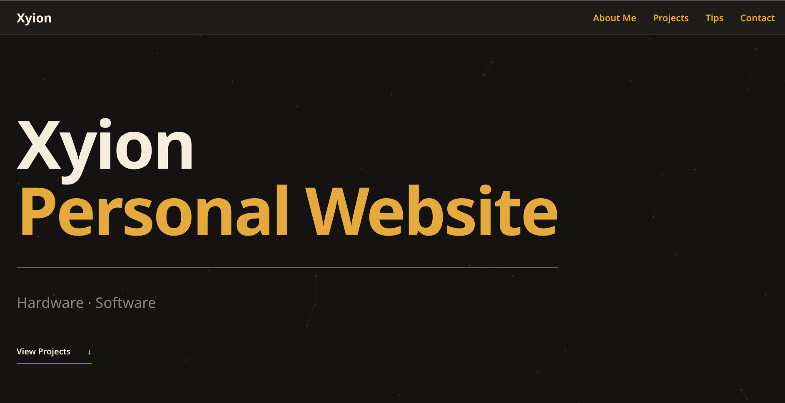

# Personal-Website
Just a normal personal website for me to learn about html/css as part of a hackclub program called Pixl. Inside I have added my pass projects and contacts. Hope you guys could learn something from my repo!
Projects Included(will create repo for each of them in the futre):

CapAble: A cap mounted device for the mute that translate sign language into spoken words with the help of MediaPipe.
VTracks: A shoes mounted device uses vibration to help the blind to navigate and avoid obstacles
        Navigation: Uses open street map and a Neo-6m GPS tracker
        Obstacle detection: Uses 1 lidar sensor on a servo and a ultrasonic sensor
Algaerythm: A floatable project that collects red tide algae on the surface of the ocean, helps fisherman to safe their fishes if red tide algae come.

